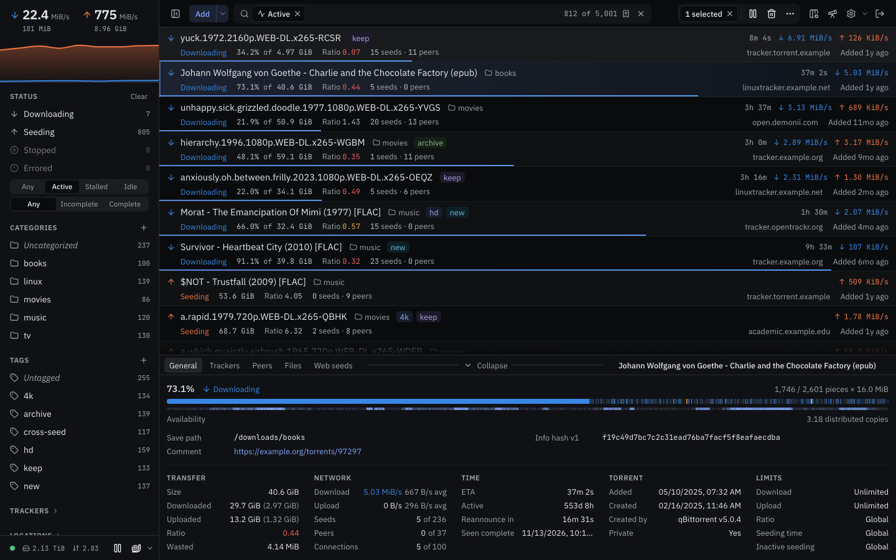
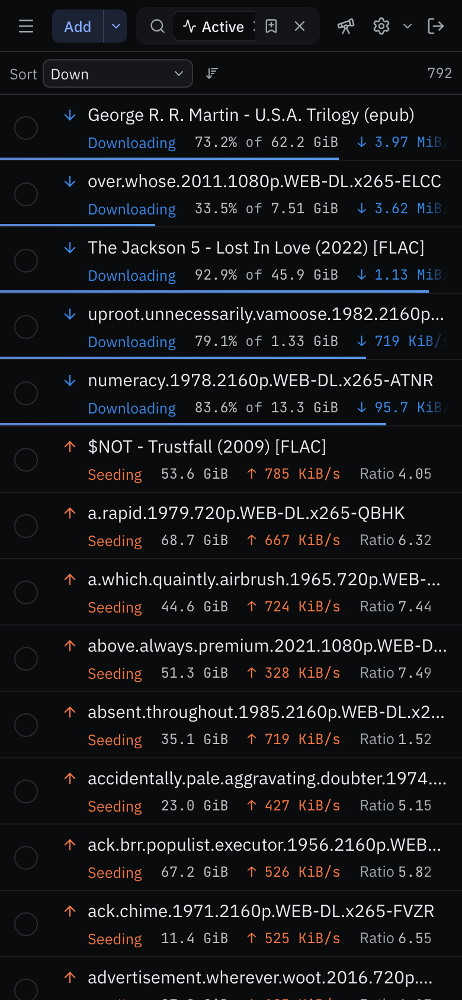
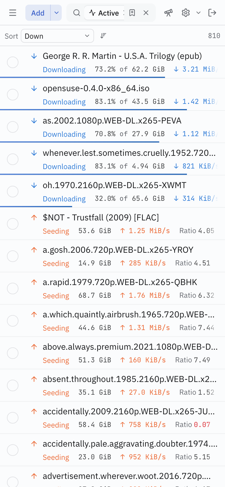

# Slake

A fast, keyboard-driven, alternative WebUI for qBittorrent 5+



## Features

- Fast with thousands of torrents
- Static assets, no separate process
- Saved filter views, plus conditions like `ratio > 2` or `size >= 100 GiB`
- Vim-style keymaps with which-key and a cheat sheet (`?`)
- Mobile layout, installable as a PWA
- Themes: [Rosé Pine](https://rosepinetheme.com), [Catppuccin](https://catppuccin.com), [Gruvbox](https://github.com/morhetz/gruvbox), [Kanagawa](https://github.com/rebelot/kanagawa.nvim), [Tokyo Night](https://github.com/folke/tokyonight.nvim), or your own `theme.css`

<p align="center">
  
  
</p>

## Install

### Script

Downloads the latest release into `~/.local/share/qbit-slake`. Rerun to update.

```sh
tmp=$(mktemp -d) \
&& curl -fsSL -o "$tmp/slake.zip" \
  https://github.com/eatsomephp/qbit-slake/releases/latest/download/qbit-slake.zip \
&& unzip -q "$tmp/slake.zip" -d "$tmp" \
&& mkdir -p ~/.local/share \
&& rm -rf ~/.local/share/qbit-slake \
&& mv "$tmp/qbit-slake" ~/.local/share/ \
&& rm -rf "$tmp" \
&& echo "$HOME/.local/share/qbit-slake"
```

Then point **Options → WebUI → Use alternative WebUI** at the printed path (qBittorrent doesn't expand `~`).

### Manual

Download `qbit-slake-<version>.zip` from [Releases](../../releases), unzip it anywhere, and point **Use alternative WebUI** at the `qbit-slake` folder.

### linuxserver.io Docker

For [linuxserver/qbittorrent](https://docs.linuxserver.io/images/docker-qbittorrent). The [Docker mod](docker-mod/README.md) installs Slake and enables the alternative WebUI on container start.

```yaml
environment:
  - DOCKER_MODS=ghcr.io/eatsomephp/qbit-slake-lsio-mod:latest
```

### Custom theme

Copy `theme.example.css` to `theme.css` in `qbit-slake/public/` and edit. Unset variables fall back to the default theme.

## Development

```sh
pnpm install
cp .env.sample .env.local   # set VITE_QBT_TARGET, or VITE_USE_MOCK=true
pnpm dev
```

`pnpm build` outputs to `qbit-slake/`.

## License

[GPL-3.0-or-later](LICENSE)
